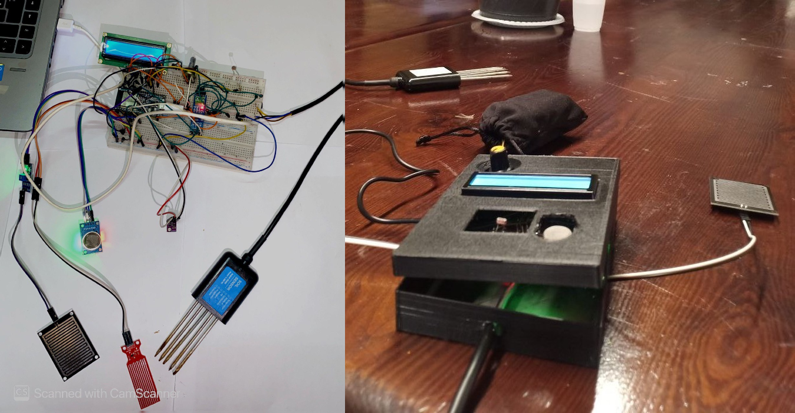
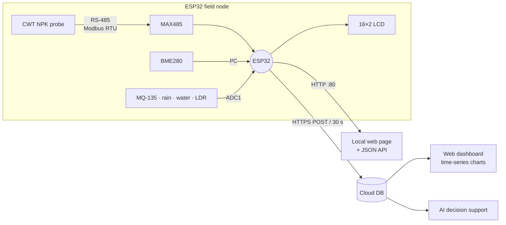
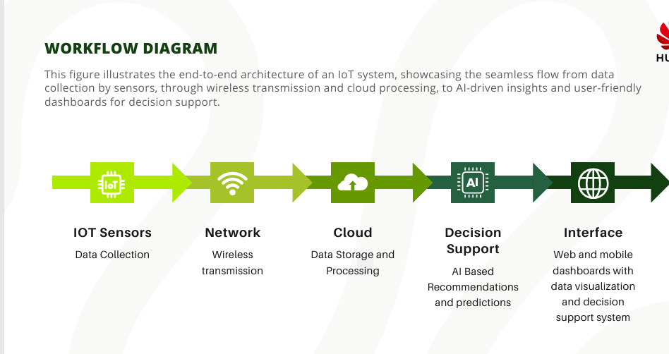
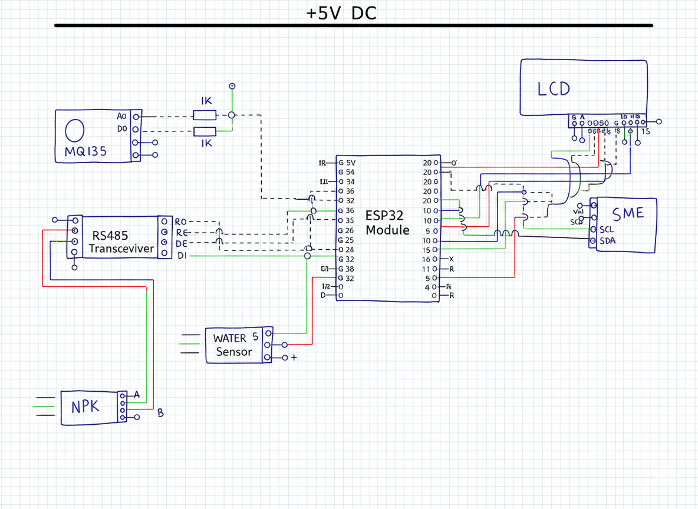
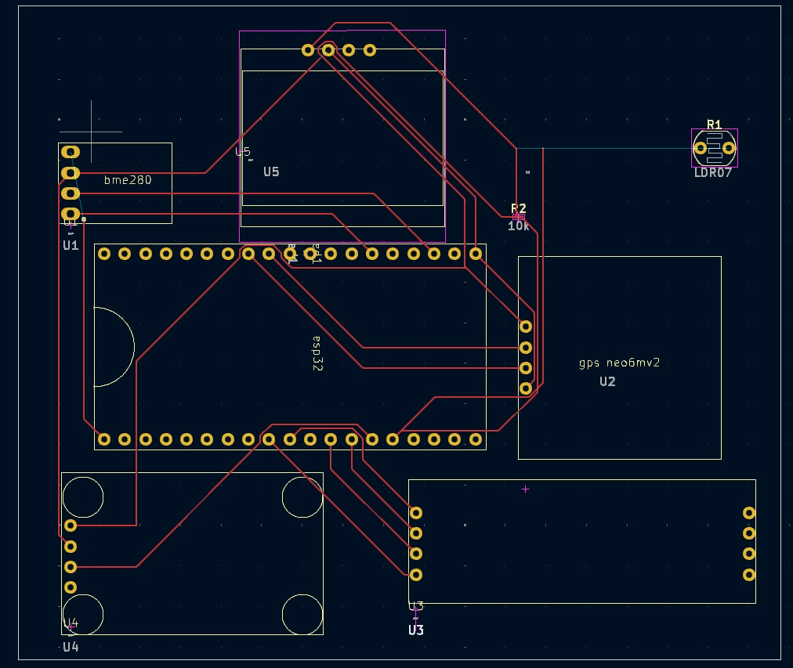
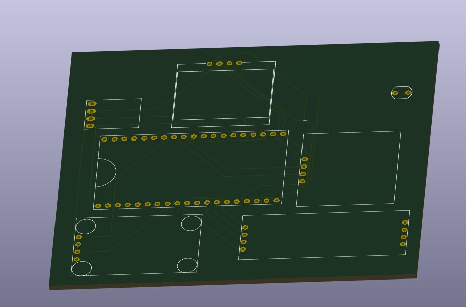
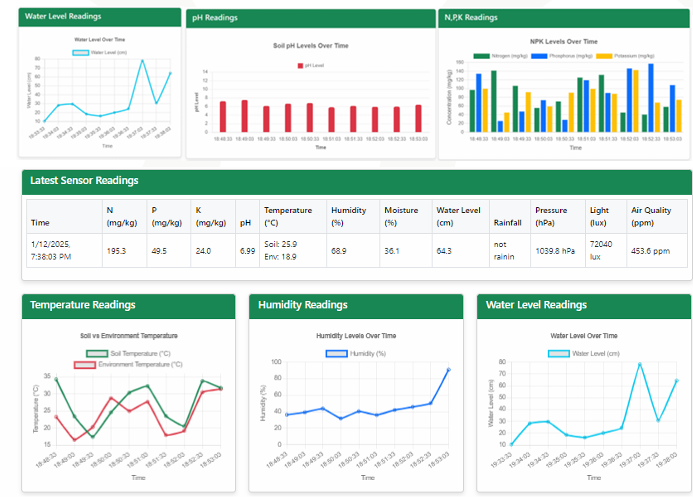
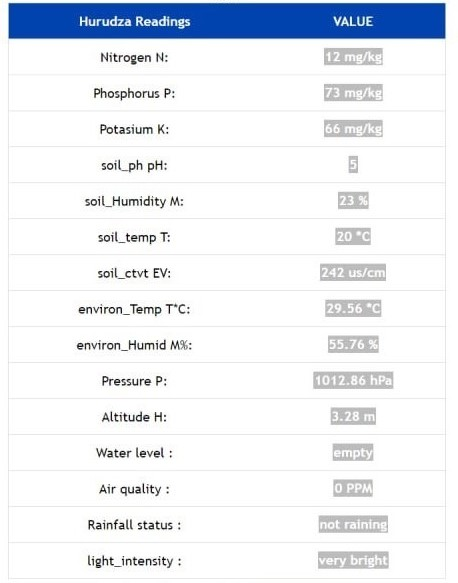

# Hurudza: Multi-Sensor IoT Node for Precision Agriculture

[](https://github.com/naimabouk/hurudza-iot-telemetry/actions/workflows/ci.yml)
[](#recognition)
[](firmware/platformio.ini)
[](LICENSE)

Hurudza is an end-to-end field monitoring system. A low-cost ESP32 node reads an industrial
**RS-485 / Modbus RTU soil probe** (N, P, K, pH, moisture, temperature, EC) together with
atmospheric, rain, water-level, air-quality and light sensors. It shows the readings on a
local LCD, serves them on a local web page, and streams them to a cloud dashboard that feeds
AI-based decision support for farmers.

<p align="center">
  
  <br><em>Breadboard prototype (left) and the assembled field unit in its 3D-printed enclosure (right).</em>
</p>

---

## Contents
- [System architecture](#system-architecture)
- [Sensor suite](#sensor-suite)
- [Firmware](#firmware)
- [Hardware](#hardware)
- [Telemetry and dashboards](#telemetry-and-dashboards)
- [Getting started](#getting-started)
- [Repository structure](#repository-structure)
- [Recognition](#recognition)

## System architecture



<p align="center"></p>

A scale-out design for multi-node deployments (edge gateway, Kafka/Spark ingestion,
TimescaleDB, Kubernetes) is documented in [`docs/images/scaleout_architecture.jpg`](docs/images/scaleout_architecture.jpg).
It is a **proposed architecture**. This repository implements the node and its single-server
telemetry path.

## Sensor suite

| Sensor | Interface | Quantities | Resolution / output |
|---|---|---|---|
| CWT 5-pin NPK soil probe (IP68) | RS-485, Modbus RTU | N, P, K · pH · moisture · soil temperature · EC | 1 mg/kg · 0.1 pH · 0.1 % · 0.1 °C · 1 µS/cm |
| BME280 | I²C | air temperature, humidity, pressure, altitude (est.) | 0.01 °C · 0.01 % · 0.01 hPa |
| MQ-135 | ADC | relative air-quality index | raw 12-bit count, uncalibrated |
| Rain board | ADC + digital | rain / no rain | comparator threshold |
| Resistive water-level probe | ADC, power-gated | reservoir level | empty / low / medium / high |
| LDR | ADC | ambient light | dark / dim / light / bright / very bright |

Full GPIO map, Modbus register table and BOM: [`hardware/pinout.md`](hardware/pinout.md).

## Firmware

The repo contains two versions:

| | [`firmware/original/`](firmware/original) (v1) | [`firmware/hurudza/`](firmware/hurudza) (v2, modular) |
|---|---|---|
| Structure | single sketch | modules: `soil_probe`, `modbus_rtu`, `sensors`, `display`, `telemetry`, `web_ui` |
| Soil probe | 7 separate requests, fixed request frames | **1 request for all 7 registers**, CRC-16 computed at runtime |
| Response check | none (byte 4 read directly) | **CRC-16, slave address and byte count validated**; typed error status |
| Register width | low byte only (values > 255 truncated) | full **16-bit** registers; signed soil temperature |
| Serial port | SoftwareSerial | ESP32 **hardware UART2** remapped to GPIO 26/27 |
| Cloud upload | only when someone opened the local page | **every 30 s** on a `millis()` schedule |
| Wi-Fi loss | blocks in `setup()` until connected | non-blocking reconnect; LCD and sensing keep running |
| BME280 | never initialized | probed at 0x76 / 0x77, flagged if missing |
| Credentials | hard-coded | `secrets.h`, excluded from git |

### Design notes

- **Half-duplex RS-485 timing.** The MAX485 is switched to transmit (DE/RE̅ high) only for
  the request. `Serial.flush()` waits for the last stop bit, then the bus is released at
  once so the probe can answer. Each reception has a bounded 500 ms deadline, so a
  disconnected probe can't stall the loop.
- **Modbus integrity.** Every response is checked with CRC-16/MODBUS (poly 0xA001, init
  0xFFFF), plus the slave address and byte count. A corrupted frame is reported as
  `BAD_CRC` and dropped instead of being sent to the cloud as a real measurement. One
  7-register transaction (≈ 19-byte response) replaces seven single-register round trips,
  which cuts bus time roughly 7×.
- **Corrosion-aware sampling.** The resistive water-level probe is powered from GPIO 4 only
  for ~10 ms per sample. Leaving DC on all the time electrolyses the exposed traces within
  days.
- **ADC1-only analog inputs.** The ESP32's ADC2 is unusable while Wi-Fi is on, so all analog
  sensors use GPIO 34–39.
- **Graceful degradation.** Each sensor reports validity separately. Missing data is left out
  of the upload rather than sent as zeros.

### Verification

- **Unit tests** ([`tests/host/test_modbus.cpp`](tests/host/test_modbus.cpp)): CRC generation
  matches the frames used in v1 and the example in the CWT manual. Register decoding is tested
  with the manual's sample response, values > 255, negative temperatures, and the error paths
  (bad CRC, wrong address, short frame, timeout, exception).
- **CI** ([`.github/workflows/ci.yml`](.github/workflows/ci.yml)) runs the unit tests and a
  full ESP32 PlatformIO build on every push.
- **Bench diagnostic** ([`tests/rs485_probe_test/`](tests/rs485_probe_test)): scans
  Modbus addresses and dumps raw frames with CRC status, to debug wiring on the bench.

> v1 is the firmware that ran on the prototype. v2 is a refactor that passes the unit tests
> and the CI build but has not been flashed to the hardware yet.

## Hardware

| Schematic | PCB layout (KiCad) | PCB 3D render |
|---|---|---|
|  |  |  |

- **Schematic:** ESP32, MAX485, NPK probe, MQ-135, water sensor, BME280 and LCD on a 5 V rail
  ([PDF](hardware/schematics/hurudza_schematic.pdf)).
- **PCB revision:** a single board replacing the breadboard. It carries footprints for the
  ESP32 DevKit, BME280, an LDR divider and a **NEO-6M GPS** for geotagged samples. GPS
  support isn't in the firmware yet.
- **Enclosure:** 3D-printed housing with an LCD window, contrast knob, optical window for the
  LDR, and cable exits for the soil and rain probes.

## Telemetry and dashboards

<p align="center">
  
  
  <br><em>Cloud dashboard (left) and the node's local web page (right).</em>
</p>

Upload fields, local JSON API and serial log format: [`docs/telemetry_api.md`](docs/telemetry_api.md).

## Getting started

```bash
git clone https://github.com/naimabouk/hurudza-iot-telemetry.git
cd hurudza-iot-telemetry/firmware
cp hurudza/secrets.example.h hurudza/secrets.h    # add Wi-Fi + endpoint credentials

# PlatformIO
pio run -t upload && pio device monitor

# or Arduino IDE: open firmware/hurudza/hurudza.ino, board "ESP32 Dev Module",
# install "Adafruit BME280 Library" and "LiquidCrystal" from the Library Manager.
```

Unit tests on any machine with a C++17 compiler:

```bash
g++ -std=c++17 -Ifirmware/hurudza tests/host/test_modbus.cpp -o test_modbus && ./test_modbus
```

## Repository structure

```
hurudza-iot-telemetry/
├── firmware/
│   ├── platformio.ini
│   ├── hurudza/                  <- v2 modular firmware (Arduino sketch folder)
│   │   ├── hurudza.ino           <- scheduler: sample / display / web / upload
│   │   ├── modbus_rtu.h          <- CRC-16, request builder, response parser (pure C++)
│   │   ├── soil_registers.h      <- CWT register map and scaling (pure C++)
│   │   ├── soil_probe.*          <- RS-485 half-duplex transactions
│   │   ├── sensors.*             <- BME280, MQ-135, rain, water level, LDR
│   │   ├── display.*             <- 16×2 LCD pages
│   │   ├── telemetry.*           <- Wi-Fi + HTTPS upload
│   │   ├── web_ui.*              <- local HTML page + JSON API
│   │   ├── config.h              <- pins, timing, thresholds
│   │   └── secrets.example.h     <- credential template (copy to secrets.h)
│   └── original/hurudza_v1.ino   <- prototype firmware (credentials redacted)
├── hardware/
│   ├── pinout.md                 <- GPIO map, Modbus registers, BOM
│   ├── schematics/
│   ├── pcb/
│   └── datasheets/CWT_NPK_soil_sensor_manual.pdf
├── docs/
│   ├── telemetry_api.md
│   └── images/
├── tests/
│   ├── host/test_modbus.cpp      <- unit tests (run in CI)
│   └── rs485_probe_test/         <- bench diagnostic sketch
└── .github/workflows/ci.yml
```

## Recognition

**Huawei Developer Competition 2024: winner, Northern Africa region.**

## Contact

**Naima Boukhiar**, LMCS Laboratory, École nationale Supérieure d'Informatique (ESI), Algiers
✉️ naima.boukhiar@univ-alger.dz

Related work: [UPMO: uncertainty-aware multi-objective optimization for smart agriculture](https://github.com/naimabouk/upmo-smart-agriculture)

## License

[MIT](LICENSE). The CWT probe manual in `hardware/datasheets/` belongs to its manufacturer and
is included for reference.
